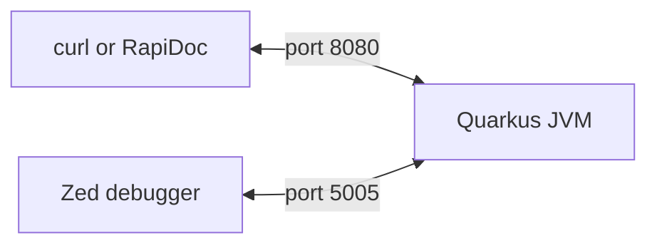
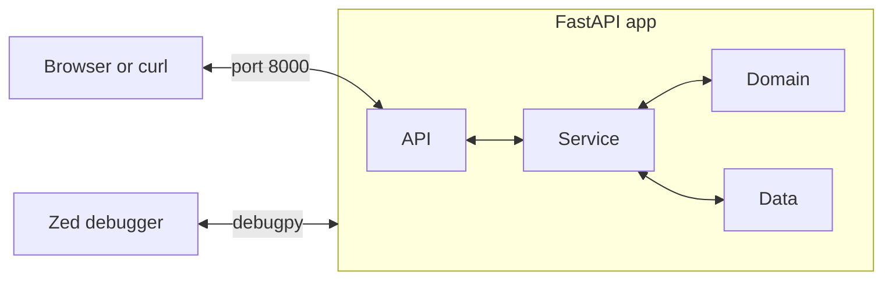

<div align="center">

# Debugging with the Zed Editor

**Attach Zed's debugger to small services and track down deliberate bugs.**


</div>

## Services

<details>
<summary><strong>Java service (Quarkus)</strong></summary>

### How it works



### Quick start

Requires JDK 21 and Maven.

```bash
cd "java service"
mvn quarkus:dev
```

| URL | Purpose |
|---|---|
| http://localhost:8080/docs | API explorer (RapiDoc, needs internet) |
| http://localhost:8080/total?prices=10&prices=20&prices=30&discount=10 | Returns `60.0`, should be `54.0` |

<details>
<summary><strong>Debugging guide (click to show or hide)</strong></summary>

### 1. Set up Zed

1. Press `ctrl-shift-x` and install the **Java** extension.
2. Open the folder containing `pom.xml`:

   ```bash
   cd "java service"
   zed .
   ```

Recent JDTLS (the extension's language server) needs Java 25+, even though the service runs on 21. If you don't have it, add this to `~/.config/zed/settings.json`:

```json
{
  "lsp": {
    "jdtls": {
      "settings": {
        "jdk_auto_download": true
      }
    }
  }
}
```

### 2. Add `.zed/debug.json`

Create it inside `java service/`:

```json
[
  {
    "label": "Attach to Quarkus (port 5005)",
    "adapter": "Java",
    "request": "attach",
    "hostName": "localhost",
    "port": 5005
  }
]
```

- `[ ]` holds the list of configurations and is required, even for just one.
- `{ }` is one configuration.

### 3. Attach

1. Run `mvn quarkus:dev` and wait for `Listening for transport dt_socket at address: 5005`.
2. Press `f4` and choose **Attach to Quarkus (port 5005)**.

### 4. Set a breakpoint

Click the gutter or press `f9` on these lines:

| File | Line | Code | Meaning |
|---|---|---|---|
| `src/PriceResource.java` | 18 | `return priceService.total(prices, discount);` | Stops before calling the service, to check the input |
| `src/PriceService.java` | 8 | `int subtotal = 0;` | Stops at the start of the calculation |

### 5. Find the bug

1. Open http://localhost:8080/docs and send `GET /total` with `prices` 10, 20, 30 and `discount` 10.
2. The response stays pending while the code is paused. That's normal.
3. At `PriceResource.java:18`, check the input, then press `f5` (continue) to reach `PriceService.java:8`.
4. Step with `f10` (over) and watch the variables until one is wrong.

### Step actions

| Action | Key | What it does |
|---|---|---|
| Step over | `f10` | Runs the whole line, including any method it calls, then stops on the next line |
| Step into | `f11` | Goes inside the method being called and stops on its first line |
| Step out | `shift-f11` | Finishes the current method and stops back where it was called |
| Continue | `f5` | Runs until the next breakpoint, or until the request finishes |

In your code, suppose you're paused at line 18 of `PriceResource.java`:

```java
return priceService.total(prices, discount);
```

- **Step over:** `total()` runs completely, with its loop and calculation happening without a stop. You don't see any of it unless a breakpoint inside it is hit.
- **Step into:** you land in `PriceService_ClientProxy`, a class Quarkus generates between your two classes, not in `total()`. Stepping into again goes deeper into Quarkus code.
- **Continue:** use this to reach your own code. It stops at the breakpoint on `PriceService.java:8`, and also gets you out if you end up in Quarkus code.
- **Step out:** once inside `total()`, this runs the rest of the method and takes you back towards line 18. If you stop in `PriceService_ClientProxy` first, step out again.

</details>

<details>
<summary><strong>What I did (shows the bug, click to show or hide)</strong></summary>

The correct answer for `prices` 10, 20, 30 and `discount` 10 is `54.0`. **The highlighted line hasn't run yet**, so its result only shows up after your next action.

#### 1. Send the request

Execution stops at `PriceResource.java:18`, and the response stays pending, which is normal.

| Variable | Expected |
|---|---|
| `prices` | `[10, 20, 30]` |
| `discount` | `10` |

#### 2. Continue

You stop at `PriceService.java:8`. `prices` and `discountPercent` are visible, but `subtotal` doesn't exist yet.

Don't use Step into here, because it takes you into Quarkus's generated code.

#### 3. Step over through the method

| Action | Now stopped on | `price` | `subtotal` | `discount` |
|---|---|---|---|---|
| Step over | 9 `for` | – | `0` | – |
| Step over | 10 `subtotal += price` | `10` | `0` | – |
| Step over | 9 `for` | – | `10` | – |
| Step over | 10 | `20` | `10` | – |
| Step over | 9 `for` | – | `30` | – |
| Step over | 10 | `30` | `30` | – |
| Step over | 9 `for` | – | `60` | – |
| Step over | 13 `double discount = ...` | – | `60` | – |
| Step over | 14 `return ...` | – | `60` | **`0.0`, should be `6.0`** |

The last row is the bug: the loop is correct, and line 13 is the first line to produce a wrong value.

#### 4. Step out

The rest of `total()` runs, and you head back to `PriceResource.java:18`. If you stop in `PriceService_ClientProxy` first, Step out again. The response is still pending.

#### 5. Continue

The request finishes and RapiDoc shows `60.0`, which matches the `discount` of `0.0` you saw.

#### 6. After the fix

Change `100` to `100.0` on line 13, save and send the request again. Repeat the same actions. Everything is the same until line 14, where `discount` is now `6.0`, and the response is `54.0`.

#### If you end up in Quarkus code

Press **Continue** if your breakpoint on line 8 is still ahead of you. Your code is the frames with your own file names in the call stack, and anything with a `jdt://` path or `unknown` isn't yours.

</details>

</details>

<details>
<summary><strong>Python service (FastAPI)</strong></summary>

### How it works



| Layer | File | Role |
|---|---|---|
| API | `api/orders.py`, `api/schemas.py` | Routes and request validation |
| Service | `services/order_service.py` | Builds and places an order |
| Domain | `domain/pricing.py` | Discounts and totals |
| Data | `data/catalog.py`, `data/order_repository.py` | Products, stock and orders, kept in memory |

Zed starts this service itself, so don't run it in a terminal while debugging.

### Quick start

Requires Python 3. Create the environment once:

```bash
cd "python service"
python3 -m venv .venv
.venv/bin/pip install -r requirements.txt
```

| URL | Purpose |
|---|---|
| http://localhost:8000/docs | API explorer (built into FastAPI) |
| `GET /products` | Products, prices and stock |
| `POST /orders` | Places an order |
| `GET /orders` | Saved orders |

<details>
<summary><strong>Debugging guide (click to show or hide)</strong></summary>

### 1. Open the repo root in Zed

```bash
zed .
```

No extension is needed, because Python debugging is built into Zed.

### 2. Check `.zed/debug.json`

Each configuration is one `{ }` in the list. This is the Python one:

```json
{
  "label": "Run Python service (port 8000)",
  "adapter": "Debugpy",
  "request": "launch",
  "module": "uvicorn",
  "args": ["main:app", "--port", "8000"],
  "cwd": "$ZED_WORKTREE_ROOT/python service",
  "python": "$ZED_WORKTREE_ROOT/python service/.venv/bin/python"
}
```

| Field | Meaning |
|---|---|
| `request` | `launch` makes Zed start the service |
| `module`, `args` | Runs `uvicorn main:app --port 8000` |
| `cwd` | The folder containing `main.py` |
| `python` | Uses the service's virtual environment |

### 3. Start the service

Press `f4` and choose **Run Python service (port 8000)**.

### 4. Set a breakpoint

Click the gutter or press `f9` on this line, then follow the request down through the layers:

| File | Line | Code | Meaning |
|---|---|---|---|
| `python service/api/orders.py` | 25 | `return order_service.place_order(...)` | Stops before the request enters the service layer |

### 5. Find the bugs

The service has **4 deliberate bugs**. It should follow these rules:

| Rule | Example |
|---|---|
| An order contains only the items from its own request | The second order doesn't include the first order's items |
| `gold` customers pay 10% less, and catalog prices never change | `apple` always costs `2.0` in `GET /products` |
| A line with 10 or more units gets 5% off | 10 apples cost `19.0` |
| A failed order changes nothing | Stock is the same as before the request |

Send orders to `POST /orders`:

```json
{
  "customer": "alice",
  "tier": "gold",
  "items": [{ "sku": "apple", "quantity": 2 }]
}
```

Products are `apple`, `pear` and `mango`. A request stays pending while the code is paused, which is normal. Data is kept in memory, so restart the debugger with `shift-f5` then `f4` for a clean start, and after any code change.

### Step actions

| Action | Key | What it does |
|---|---|---|
| Step over | `f10` | Runs the whole line, including any function it calls, then stops on the next line |
| Step into | `f11` | Goes inside the function being called |
| Step out | `shift-f11` | Finishes the current function and stops back where it was called |
| Continue | `f5` | Runs until the next breakpoint, or until the request finishes |

</details>

<details>
<summary><strong>What I did (shows the bugs, click to show or hide)</strong></summary>

Restart the debugger before each bug. **The highlighted line hasn't run yet**, so its result only shows up after your next action.

#### Bug 1: orders include earlier orders' items

Send `alice` with 1 `apple`, then `bob` with 1 `pear`, both `standard`. The second total should be `1.5`, but it's `3.5` with 2 lines.

| Breakpoint | Action | Check |
|---|---|---|
| `services/order_service.py:11` during `bob`'s request | Look at `order` | `order["lines"]` already holds the apple before anything is added |

The default `lines=[]` in `_new_order` is created once, so every order shares the same list.

```python
def _new_order(customer):
    return {"customer": customer, "lines": []}
```

#### Bug 2: a gold order changes the catalog price

Send a `gold` order for 2 `apple`. The response is correct (`unit_price` `1.8`, `total` `3.6`), but `GET /products` now shows `apple` at `1.8` instead of `2.0`, and each gold order lowers it further.

| Breakpoint | Action | Check |
|---|---|---|
| `domain/pricing.py:8` | Look at `product["price"]`, then Step over | It goes from `2.0` to `1.8` |

`find_product` returns the catalog's own dictionary, so `apply_tier` is changing the catalog itself.

```python
def apply_tier(product, tier):
    rate = TIER_RATES.get(tier, 0.0)
    return {**product, "price": round(product["price"] * (1 - rate), 2)}
```

#### Bug 3: exactly 10 units gets no bulk discount

Send a `standard` order for 10 `apple`. The total should be `19.0`, but it's `20.0`.

| Breakpoint | Action | Check |
|---|---|---|
| `domain/pricing.py:14` | Step over | `quantity` is `10`, and the discount line is skipped |

`10 > 10` is false. Change line 14 in `domain/pricing.py`:

```python
if quantity >= BULK_MIN_QUANTITY:
```

#### Bug 4: a failed order still takes stock

Send a `standard` order with 2 `apple` and 99 `mango`. You get a `400`, which is correct, but `GET /products` shows `apple` stock at `18` instead of `20`.

| Breakpoint | Action | Check |
|---|---|---|
| `services/order_service.py:31` | Continue through both items | Apple's stock is reduced on the first pass, then mango raises `OrderError` on the second |

Stock is reduced before the whole order is known to be valid. Remove line 31 from `_build_line`, and reduce stock in `place_order` once every line has been built:

```python
for item in items:
    order["lines"].append(_build_line(item, tier))
for line in order["lines"]:
    catalog.reduce_stock(line["sku"], line["quantity"])
```

</details>

</details>
