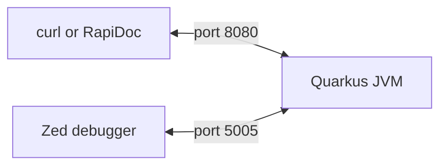

<div align="center">

# Debugging with the Zed Editor

**Attach Zed's debugger to a small Quarkus service and track down a deliberate bug.**


</div>

## How it works



## Quick start

Requires JDK 21 and Maven.

```bash
cd "java service"
mvn quarkus:dev
```

| URL | Purpose |
|---|---|
| http://localhost:8080/docs | API explorer (RapiDoc, needs internet) |
| http://localhost:8080/total?prices=10&prices=20&prices=30&discount=10 | Returns `60.0`, should be `54.0` |

<details>
<summary><strong>Debugging guide (click to show or hide)</strong></summary>

### 1. Set up Zed

1. Press `ctrl-shift-x` and install the **Java** extension.
2. Open the folder containing `pom.xml`:

   ```bash
   cd "java service"
   zed .
   ```

Recent JDTLS (the extension's language server) needs Java 25+, even though the service runs on 21. If you don't have it, add this to `~/.config/zed/settings.json`:

```json
{
  "lsp": {
    "jdtls": {
      "settings": {
        "jdk_auto_download": true
      }
    }
  }
}
```

### 2. Add `.zed/debug.json`

Create it inside `java service/`:

```json
[
  {
    "label": "Attach to Quarkus (port 5005)",
    "adapter": "Java",
    "request": "attach",
    "hostName": "localhost",
    "port": 5005
  }
]
```

- `[ ]` holds the list of configurations and is required, even for just one.
- `{ }` is one configuration.

### 3. Attach

1. Run `mvn quarkus:dev` and wait for `Listening for transport dt_socket at address: 5005`.
2. Press `f4` and choose **Attach to Quarkus (port 5005)**.

### 4. Set a breakpoint

Click the gutter or press `f9` on these lines:

| File | Line | Code | Meaning |
|---|---|---|---|
| `src/PriceResource.java` | 18 | `return priceService.total(prices, discount);` | Stops before calling the service, to check the input |
| `src/PriceService.java` | 8 | `int subtotal = 0;` | Stops at the start of the calculation |

### 5. Find the bug

1. Open http://localhost:8080/docs and send `GET /total` with `prices` 10, 20, 30 and `discount` 10.
2. The response stays pending while the code is paused. That's normal.
3. Step with `f10` (over), `f11` (into) and `f5` (continue), and watch the variables until one is wrong.

### Step actions

| Action | Key | What it does |
|---|---|---|
| Step over | `f10` | Runs the whole line, including any method it calls, then stops on the next line |
| Step into | `f11` | Goes inside the method being called and stops on its first line |
| Step out | `shift-f11` | Finishes the current method and stops back where it was called |

In your code, suppose you're paused at line 18 of `PriceResource.java`:

```java
return priceService.total(prices, discount);
```

- **Step over:** `total()` runs completely, with its loop and calculation happening without a stop. You don't see any of it unless a breakpoint inside it is hit.
- **Step into:** you go inside `PriceService.total()` and can follow it line by line.
- **Step out:** once inside `total()`, this runs the rest of the method and takes you back to line 18.

</details>
